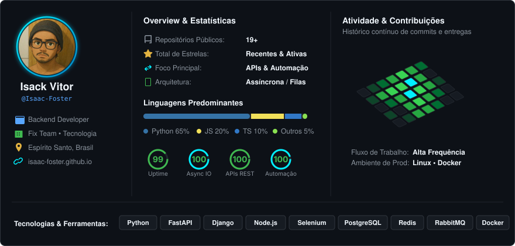

  <!-- THE LAST OF US PART II // DEVELOPER WORKSTATION BANNER -->
  

    

  <!-- PROFILE VIEWS (TLOU2 Amber) -->
  

    
  

  <!-- TYPING SVG (TLOU2 Amber) -->
  

  
<b>Desenvolvedor Backend | Python • FastAPI • Django • Node.js • RPA</b>

  <!-- SOCIAL & PORTFOLIO LINKS (Flat-Square Badges) -->
  

    
    &nbsp;
    
    &nbsp;
    
    &nbsp;
    
    &nbsp;
    
  

---

### Sobre Mim

Me chamo **Isack Vitor**, tenho <!-- AGE:START -->26<!-- AGE:END --> anos e sou natural do Espírito Santo. Atualmente, estou cursando **Ciência da Computação na ESTÁCIO** e desenvolvendo soluções backend e robôs de automação na **Fix Team**.

- **Backend & APIs**: Construção de microsserviços escaláveis e APIs RESTful em **Python** (FastAPI, Django, Flask) e **Node.js** com TypeScript.
- **Automação & RPA**: Criação de robôs de alta vazão, scrapers avançados com evasão de bloqueios via **Selenium** e **Asyncio**.
- **Persistência & Caching**: Modelagem relacional e NoSQL com **PostgreSQL, MySQL, MongoDB** e cache ultrarrápido em memória com **Redis**.
- **Mensageria Assíncrona**: Arquiteturas desacopladas e processamento de eventos orientados a filas com **RabbitMQ**.
- **Portfólio Interativo**: Conheça projetos e detalhes técnicos em: **[isaac-foster.github.io](https://isaac-foster.github.io/)**

---

### Dashboard de Métricas & Atividade

  

---

### Tecnologias & Ferramentas

<table>
  <thead>
    <tr style="background-color: #0d1117;">
      <th align="center" width="25%"><b>BACKEND CORE</b></th>
      <th align="center" width="25%"><b>AUTOMAÇÃO &amp; RPA</b></th>
      <th align="center" width="25%"><b>BANCOS &amp; CACHE</b></th>
      <th align="center" width="25%"><b>DEVOPS &amp; FERRAMENTAS</b></th>
    </tr>
  </thead>
  <tbody>
    <tr>
      <td align="center" valign="top">
         
        
          
        <b>Python • FastAPI</b> 
        Django • Flask
      </td>
      <td align="center" valign="top">
         
        
          
        <b>Node.js • TypeScript</b> 
        Selenium • RPA • Scraping
      </td>
      <td align="center" valign="top">
         
        
          
        <b>PostgreSQL • Redis</b> 
        RabbitMQ • MongoDB • MySQL
      </td>
      <td align="center" valign="top">
         
        
          
        <b>Docker • Linux</b> 
        Git • Postman • REST APIs
      </td>
    </tr>
  </tbody>
</table>

---

### Projetos em Destaque

<!-- PROJETO 01: ANDREZA CORREIOS -->
<table>
  <tr>
    <td width="200" align="center" valign="middle">
      
    </td>
    <td valign="top">
      
      <h3>Andreza Correios — Bot de Rastreamento</h3>
      

        Bot conversacional no Telegram para <b>monitoramento autônomo e rastreamento de encomendas em tempo real</b> diretamente conectado à API dos Correios. Disparo imediato de notificações push a cada alteração de rota, fiscalização ou entrega.
      

      

        <b>Tecnologias:</b> <code>Python</code> · <code>Telegram Bot API</code> · <code>Asyncio</code> · <code>Redis</code> · <code>API Correios</code>
      

      

        
        &nbsp;
        
      

    </td>
  </tr>
</table>

 

<!-- PROJETO 02: AYU PROMOTIONS ENGINE -->
<table>
  <tr>
    <td width="200" align="center" valign="middle">
      
    </td>
    <td valign="top">
      
      <h3>AYU — Deals &amp; Affiliate Engine (Fix Team)</h3>
      

        Motor inteligente de varredura e monitoramento de promoções conectado diretamente à <b>API oficial da Shopee</b>. Conversão automatizada de links de afiliados, persistência, controle de concorrência com filas assíncronas e disparo massivo em alta frequência para canais do Telegram.
      

      

        <b>Tecnologias:</b> <code>Python</code> · <code>FastAPI</code> · <code>API Shopee</code> · <code>Asyncio</code> · <code>Redis</code> · <code>Filas</code> · <code>Telegram API</code>
      

      

        
        &nbsp;
        
      

    </td>
  </tr>
</table>

 

<!-- REPOSITÓRIOS EM DESTAQUE -->

<table>
  <tr>
    <td width="50%" valign="top">
      

        
      

    </td>
    <td width="50%" valign="top">
      

        
      

    </td>
  </tr>
</table>

---

### Estatísticas do GitHub

<table>
  <tr>
    <td align="center" valign="middle">
      
    </td>
    <td align="center" valign="middle">
      
    </td>
  </tr>
</table>

 

 

<!-- FOOTER -->

  
<i>"Quando você estiver perdido na escuridão, procure a luz."</i> • <b>Endure and survive.</b>

  

    
    &nbsp;
    
    &nbsp;
    
  

  
Fix Team © 2026 • Desenvolvido com resiliência por Isack Vitor

