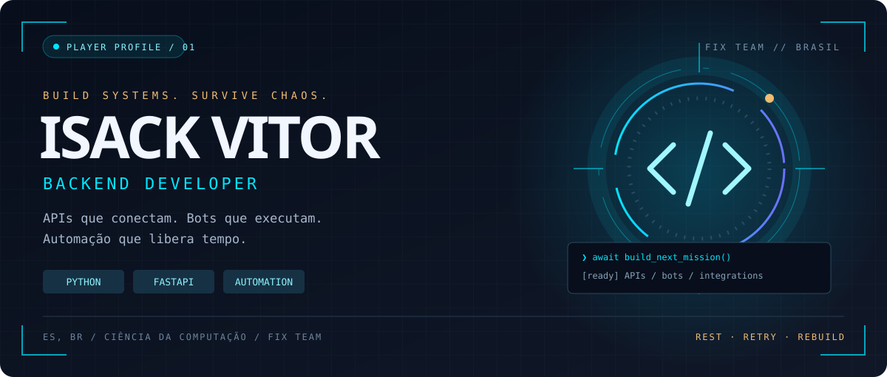
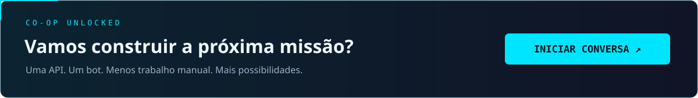

 

  

 

## ⚡ PLAYER DATA

<table>
<tr>
<td width="58%" valign="top">
<h3>Não é sobre escrever mais código.</h3>

É sobre fazer sistemas trabalharem por você.

Sou <b>Isack Vitor</b>, desenvolvedor backend do Espírito Santo. Construo <b>APIs, bots e automações</b> na <b>Fix Team</b> e curso Ciência da Computação na ESTÁCIO.

Do rastreamento de encomendas ao radar de ofertas: integrações reais, processamento assíncrono e menos rotina manual.

</td>
<td width="42%" valign="top">
<h3>◈ Character loadout</h3>

🐍 <b>Classe</b> · Backend / Python

🛰️ <b>Especialidade</b> · APIs &amp; integrações

🤖 <b>Habilidade</b> · Automação &amp; RPA

🏕️ <b>Guilda</b> · Fix Team

📍 <b>Checkpoint</b> · Espírito Santo, BR

</td>
</tr>
</table>

## 🧬 TECH LOADOUT

<table>
<tr><td align="center"><h3>⚔️ Backend core</h3>
APIs · regras de negócio · microsserviços
</td><td align="center"><h3>🛠️ Secondary weapons</h3>
Integrações · bots · web scraping · RPA
</td></tr>
<tr><td align="center"><h3>💾 Data &amp; signals</h3>
Persistência · cache · mensageria
</td><td align="center"><h3>📡 Base operations</h3>
Ambientes · versionamento · testes de APIs
</td></tr>
</table>

## 🎯 MISSION SELECT

<table>
<tr>
<td width="50%" valign="top">

<h3>📦 ANDREZA CORREIOS</h3>

Encomendas no radar. Bot no Telegram integrado à API dos Correios, com rastreamento automático e notificações de mudanças de rota ou entrega.

<code>Python</code> <code>Asyncio</code> <code>Redis</code> <code>Telegram API</code>

<a href="https://www.linkedin.com/posts/isack-foster_andreza-correios-share-7456446986091716608-0RxP">Ver apresentação ↗</a>
</td>
<td width="50%" valign="top">

<h3>⚡ AYU PROMOTIONS ENGINE</h3>

Ofertas antes de todo mundo. Integração com a API oficial da Shopee, conversão de links de afiliados e distribuição automatizada no Telegram.

<code>Python</code> <code>FastAPI</code> <code>Redis</code> <code>Filas</code> <code>API Shopee</code>

<a href="https://t.me/AYUPROMOS">Explorar canal ↗</a>
</td>
</tr>
</table>

<b>🗃️ SIDE QUESTS — abrir arquivos de missão</b>

| Repositório | Acesso |
| :--- | :--- |
| `linkedin_bot` | [Explorar código ↗](https://github.com/Isaac-Foster/linkedin_bot) |
| `fastapi-login-boilerplate` | [Explorar código ↗](https://github.com/Isaac-Foster/fastapi-login-boilerplate) |
| Todos os repositórios | [Abrir mapa completo ↗](https://github.com/Isaac-Foster?tab=repositories) |

## 📊 SAVE FILE / GITHUB

Dados públicos do GitHub. Cards e contador dependem de serviços externos.

 

<a href="mailto:isack.foster.ofc@gmail.com">E-mail</a> · <a href="https://www.linkedin.com/in/isack-foster/">LinkedIn</a> · <a href="https://isaac-foster.github.io/">Portfólio completo</a>

Souls na persistência. The Last of Us na sobrevivência. Fix Team na construção.

