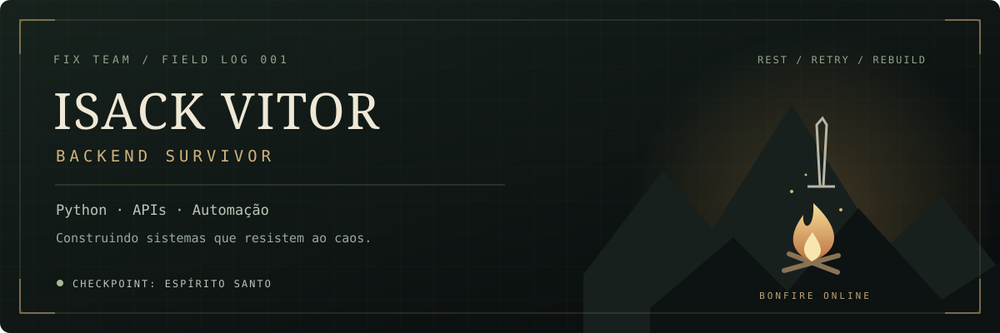
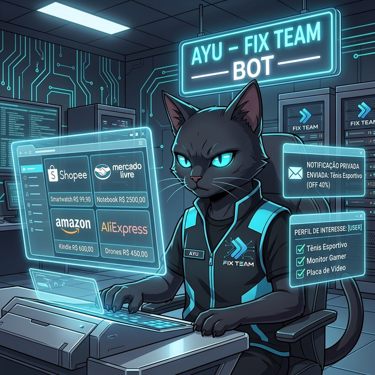

  

  
UM PERFIL. UM INVENTÁRIO. VÁRIAS MISSÕES.

  <a href="https://www.linkedin.com/in/isack-foster/">LinkedIn</a> ·
  <a href="https://t.me/lzaacFoster">Telegram</a> ·
  <a href="mailto:isack.foster.ofc@gmail.com">E-mail</a> ·
  <a href="https://isaac-foster.github.io/">Portfólio</a>

    
  

---

> **CHECKPOINT DESBLOQUEADO**
> Aqui, bugs são bosses. Logs são pistas. Cada deploy é uma nova expedição.
> A estética é de sobrevivência; o trabalho é construir soluções reais.

### 01 / Ficha do personagem

Sou **Isack Vitor**, desenvolvedor backend do **Espírito Santo**, estudante de **Ciência da Computação na ESTÁCIO** e parte da **Fix Team**.

Minha especialidade: conectar sistemas, automatizar trabalho repetitivo e transformar regras de negócio em **APIs RESTful, bots e microsserviços**.

| Atributo | Equipamento real |
| :--- | :--- |
| **Classe** | Desenvolvedor Backend |
| **Arma principal** | Python, FastAPI, Django e Flask |
| **Arma secundária** | Node.js, JavaScript e TypeScript |
| **Especialidade** | Automação, RPA e web scraping com Selenium |
| **Base de operações** | Fix Team |

<a href="#02--inventário">[ Abrir inventário ]</a> &nbsp; <a href="#03--registro-de-missões">[ Explorar missões ]</a> &nbsp; <a href="#04--acender-a-próxima-fogueira">[ Iniciar coop ]</a>

### 02 / Inventário

Sem barras de habilidade arbitrárias: cada slot mostra ferramentas que uso.

| Slot | Tecnologias | Uso em campo |
| :--- | :--- | :--- |
| **Combate principal** | `Python` `FastAPI` `Django` `Flask` | Backend, APIs e regras de negócio |
| **Kit secundário** | `Node.js` `JavaScript` `TypeScript` | Serviços e integrações |
| **Suprimentos** | `PostgreSQL` `MySQL` `MongoDB` | Persistência e modelagem de dados |
| **Comunicação** | `Redis` `RabbitMQ` `Asyncio` | Cache, filas e processamento assíncrono |
| **Reconhecimento** | `Selenium` `Web Scraping` `RPA` | Robôs e automação de rotinas |
| **Acampamento** | `Docker` `Linux` `Git` `Postman` | Ambiente, versionamento e testes de APIs |

<b>Inspecionar estilo de jogo</b>

- **Explorar:** entender o problema e as integrações antes de construir.
- **Preparar:** modelar dados e separar responsabilidades.
- **Executar:** criar APIs, bots e automações para o fluxo real.
- **Persistir:** usar filas, cache e processamento assíncrono quando o cenário pede.

### 03 / Registro de missões

#### Missão I — Nenhuma encomenda fica para trás

**Andreza Correios** · Rastreamento automático de encomendas no Telegram, integrado à API dos Correios, com notificações a cada alteração de rota ou entrega.

- **Objetivo:** acompanhar encomendas sem consultar cada código manualmente.
- **Equipamento:** `Python` `Telegram Bot API` `Asyncio` `Redis` `API Correios`
- **Pontos de acesso:** [Testar bot ↗](https://t.me/Andreza_correios_bot) · [Ver apresentação ↗](https://www.linkedin.com/posts/isack-foster_andreza-correios-share-7456446986091716608-0RxP)

---

#### Missão II — Encontrar recursos antes de todo mundo

**AYU — Promotions & Deals Engine** · Radar de ofertas com integração à API oficial da Shopee, conversão de links de afiliados, persistência e distribuição em canais do Telegram.

- **Objetivo:** transformar ofertas em um fluxo automatizado de descoberta e publicação.
- **Equipamento:** `Python` `FastAPI` `API Shopee` `Asyncio` `Redis` `Filas` `Telegram API`
- **Pontos de acesso:** [Acessar bot ↗](https://t.me/ayupromobot) · [Explorar canal ↗](https://t.me/AYUPROMOS)

<b>Missões secundárias / abrir repositórios</b>

- [**linkedin_bot**](https://github.com/Isaac-Foster/linkedin_bot)
- [**fastapi-login-boilerplate**](https://github.com/Isaac-Foster/fastapi-login-boilerplate)
- [**Explorar todos os repositórios**](https://github.com/Isaac-Foster?tab=repositories)

### 04 / Acender a próxima fogueira

Tem uma API para construir, um processo para automatizar ou uma integração que precisa sair do papel?

**Vamos abrir uma nova missão.**

[Enviar mensagem no Telegram](https://t.me/lzaacFoster) · [Conversar por e-mail](mailto:isack.foster.ofc@gmail.com) · [Conhecer meu portfólio](https://isaac-foster.github.io/)

---

  <b>REST. RETRY. REBUILD.</b> 
  Inspirado na atmosfera de Souls e The Last of Us. Identidade própria, projetos reais. 
  O contador depende de serviço externo e pode ficar temporariamente indisponível.

